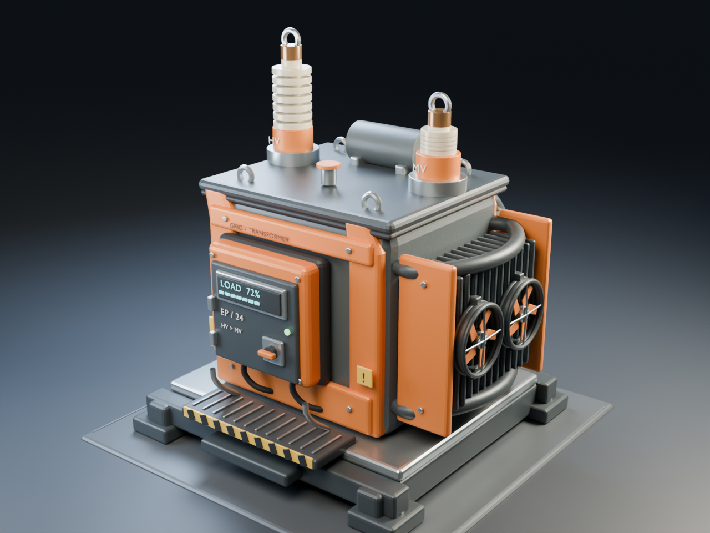

# Enhanced Power

Mod reference: `EnhancedPower`.

A Satisfactory mod that makes the power grid a layout puzzle: voltage tiers on
wires, transformers, transmission loss, local overloads, and late-game
superconductors.

Status: design and asset development. The Blender model and interactive browser
prototype run independently; an installable game mod is not available.

## Design rules

- Fun first, realism second.
- No busywork: rules apply to wires and grid buildings, never to individual
  machines.
- The vanilla power line is the LV tier. A factory floor plays like vanilla.

## Documents

- [Design](docs/design.md): mechanics and the reasons for them.
- [Roadmap](docs/roadmap.md): critical path and later phases.
- [Prior art](docs/prior-art.md): existing Satisfactory and Minecraft mods.
- [Development](docs/development.md): source contracts and transformer experiment blockers.
- [Planned player guide](docs/player-guide.md): factory-scale LV wiring and grid choices.
- [Asset pipeline](docs/asset-pipeline.md): modeling, rendering, and game-import boundaries.
- [Contributing](CONTRIBUTING.md): isolated environments and contribution evidence.

## Visual prototypes

- [Transformer model](assets/transformer/README.md): editable Blender scene,
  reproducible generator, and rendered views.
- [Grid UI](assets/ui/README.md): interactive browser prototype with simulated
  readings, not a connection to a running game.

The asset environment does not require Unreal, Wine, MSVC, or Wwise:

```sh
nix develop .#assets
```



## License

AGPL-3.0-or-later. See [LICENSE](LICENSE).
